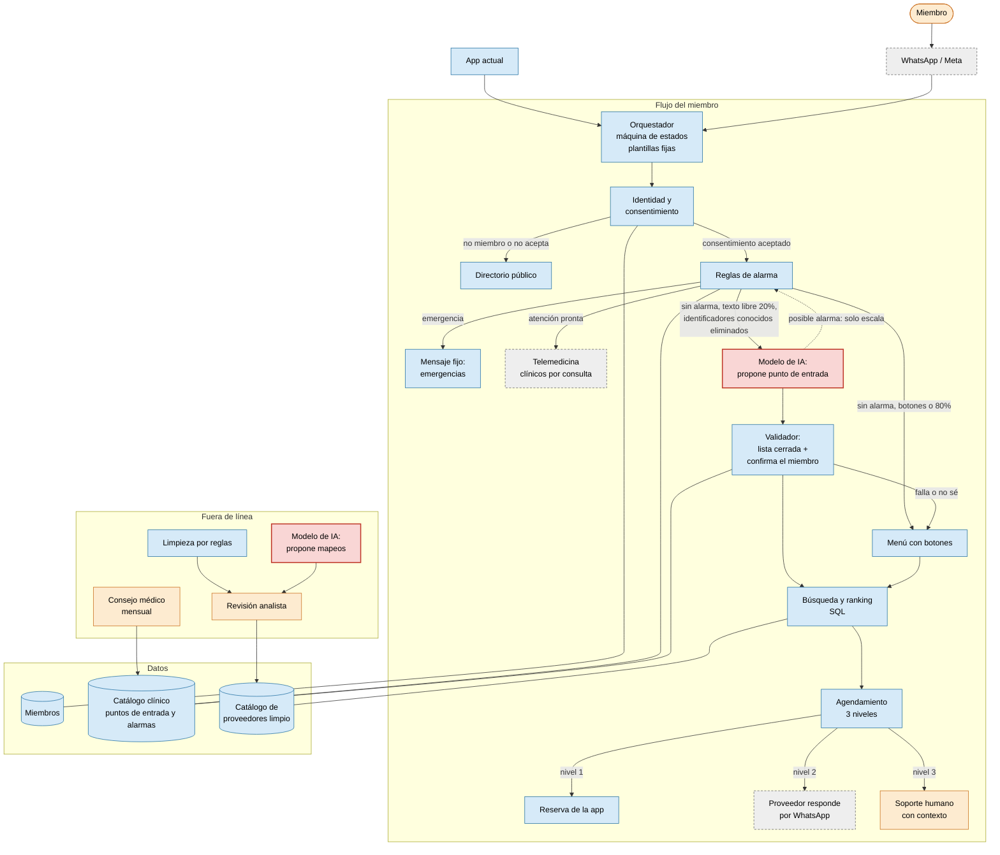

# Copiloto Salud360: propuesta de arquitectura

Enrique Quiroz. Noviembre de 2026.

Respuesta al challenge "Copiloto Salud360" para el CEO y el panel técnico. Las cifras del brief llevan su sección (§01 a §10); los supuestos van marcados como "Supuesto". Moneda: USD.

## D1. La respuesta

**Qué construimos.** Un asistente por WhatsApp que lleva al miembro de "me duele el hombro" a una sede de la red con precio fijo y una cita pedida, en un solo chat. Razón: el miembro no sabe por dónde empezar y el directorio no lo ayuda (§02).

**Qué nos negamos a construir.** Un modelo de IA que decide a qué especialista ir según los síntomas. Razón: eso es triaje (decidir urgencia o tipo de atención a partir de síntomas), un acto clínico, y no hay médico en planta (§05). En su lugar, el sistema dice "por dónde empezar" dentro de una lista cerrada que firma el consejo médico, y ante una señal de alarma dice "a emergencias" o "habla con un clínico".

| Mandato (§04) | Decisión | Lo que le diríamos a quien lo pidió |
|---|---|---|
| M1, CEO: síntomas, especialista y cita | Modificar | "Sí al chat que va de lo que te pasa a la cita. Qué especialista ver lo decide una lista que firma el consejo, no la IA. La reserva es inmediata solo donde hay agenda (41%, §03); en el resto pedimos la cita por el miembro" |
| M2, CTO: mejor modelo, base en el prompt | Rechazar el método, mantener el objetivo | "Precios y disponibilidad saldrán siempre de la base. Meterla en el prompt no la corrige, cuesta USD 9,70 por conversación y la envía entera a un tercero" |
| M3, CEO: producción en 8 semanas | Aceptar la fecha, recortar alcance | "En la semana 8 sale un piloto por WhatsApp para tus tres cuentas, con cinco puntos de entrada y datos limpios. No el producto nacional" |
| M4, CFO: sin costo significativo | Aceptar y cuantificar | "En régimen cuesta unos 4 centavos por miembro al mes (1,34% del margen). Lo que pesa es WhatsApp, no la IA" |
| M5, jefa de experiencia: WhatsApp | Aceptar con condiciones | "Sí, con consentimiento antes de cualquier texto de salud y botones en vez de texto: Meta cobra cada mensaje" |

**La idea central.** El producto funciona sin la IA. La IA es una pieza apagable que acorta el camino a quien escribe en vez de tocar botones; si se apaga, el miembro llega a la misma sede con el mismo precio. El problema de fondo no es la falta de IA sino los datos de proveedores: 63% con precios completos, 41% con disponibilidad estructurada, 214 formas de escribir especialidades (§03). Por eso los datos van primero (D2) y el riesgo que puede matar el proyecto está en la red de proveedores, no en el modelo (D7). El ahorro en soporte paga la operación del copiloto; el retorno real es no perder cuentas corporativas en la renovación, y es la hipótesis que se va a medir (D4).

## D2. Arquitectura

**Decisión:** un flujo determinista (máquina de estados: el código sabe en qué paso está cada conversación y qué respuestas acepta) que funciona completo sin IA. El modelo es opcional: traduce el texto libre a una opción de una lista cerrada, después de las reglas de alarma. Un interruptor de configuración lo apaga sin desplegar código. Un solo backend sirve a WhatsApp (M5) y a la app (M1).

Colores: rojo, modelo de IA; azul, determinista; gris punteado, tercero; naranja, persona. La línea punteada indica que el modelo solo puede escalar una alarma.

**Fronteras del modelo (§06)**

| Dónde participa | De qué puede ser autoridad | Qué nunca responde solo |
|---|---|---|
| Interpretar el texto libre del miembro | Proponer un punto de entrada de la lista cerrada; el miembro confirma con un botón | Especialista fuera de la lista, diagnóstico, gravedad, cualquier recomendación clínica |
| Extraer datos logísticos del mismo texto | Ubicación, horario, para quién es la cita; validados contra listas y confirmados | Qué proveedor elegir, precios, disponibilidad, horarios reales |
| Señal de posible alarma | Solo escalar al mismo mensaje fijo que las reglas | Bajar una urgencia, anular una regla, decir "no es grave" |
| No participa | Nada | Precios, ranking, agendamiento, consentimiento, identidad, textos al miembro, mensajes a proveedores |

Falla, demora de más de 3 segundos o salida fuera de la lista equivalen a "no sé": el miembro ve el menú.

**Decisiones que más se van a cuestionar**

| Decisión | Alternativa descartada | Razón |
|---|---|---|
| Flujo determinista, modelo opcional | Agente de IA que conduce la conversación | No se puede acotar ni probar con datos de salud y sin equipo de ML (§05) |
| El modelo solo clasifica en la lista del consejo | Recomendar especialista (M1 literal) | Es triaje sin médico en planta (§05) |
| Precios y disponibilidad por consulta SQL | Base entera en el prompt (M2) | La base está mal en origen; el prompt no la arregla, cuesta en cada mensaje (D4) y la envía a un tercero |
| Modelo pequeño con salida estructurada (respuesta forzada a un esquema), con ejemplos y sin entrenar | "El mejor modelo" (M2) o clasificador propio | Clasificar en una lista no requiere el modelo más caro; no hay ingenieros de ML ni datos etiquetados (§05) |
| Todo texto al miembro es plantilla | Respuestas redactadas por el modelo | Sin alucinaciones en lo que lee el miembro; revisión legal simple |
| Alarmas antes del modelo; el modelo solo escala | Que el modelo evalúe urgencia | La seguridad no puede depender de una pieza probabilística que cambia de versión |
| Medicina general por defecto; telemedicina solo por regla o pedido | Telemedicina ante la duda | Cuesta 9,40 / 1,85 = ~5 contactos de soporte; quedan ~800 consultas libres (3.200 - 2.400, §03) |
| Servicios administrados: serverless (código por evento sin administrar servidores), base relacional, cola | Servidores propios | Sin SRE; los mismos 4 ingenieros mantienen la app (§05) |

**Datos de proveedores, fuera de línea.** La analista limpia en lotes: taxonomía para los 214 nombres, duplicados por teléfono compartido (18%) que decide una persona, y precios faltantes (37%) que nunca se estiman (§03). Solo entra la sede "publicable": activa, especialidad canónica, teléfono verificado y precio del servicio.

**Datos de salud y Ley 8968 (§05)**
- **Consentimiento** por botón antes de cualquier texto libre: qué se procesa, qué terceros lo ven (Meta y el proveedor del modelo), cuánto se guarda, cómo revocar. La letra la valida el abogado.
- **Se guarda** consentimiento, punto de entrada, sede y estado de la cita. El texto libre se borra al cerrar la conversación y nunca entra en los registros técnicos.
- **Qué viaja a cada subprocesador** (tercero que procesa datos por cuenta de Salud360): a Meta, lo que el miembro escribe (inevitable con M5). Al proveedor del modelo, solo el texto, tras un filtro que elimina identificadores conocidos (nombre del titular y dependientes, teléfono, afiliado, correo, documento). Al proveedor de la cita, nombre, servicio y horario, nunca síntomas.
- **Limitación honesta:** no es anónimo. "A mi hija María Rodríguez le duele la muela desde que fuimos a Heredia" trae un tercero y un lugar que el filtro no conoce. Por eso el contrato de subprocesador (sin retención ni entrenamiento) es condición para encender el modelo.

**Agendamiento en tres niveles.** Solo el 41% tiene disponibilidad estructurada y no se puede obligar a nadie (§03, §05).
1. **Reserva directa** con el motor de reservas de la app (§01).
2. **Solicitud al proveedor** por plantilla de WhatsApp con botones; sin respuesta en el plazo, siguiente sede. Solo sedes que respondieron a la campaña de precios (prueba de vida), con 2 o 3 sedes ancla por punto de entrada.
3. **Contacto asistido:** teléfono y precio, más traspaso a soporte con contexto.

El ranking premia disponibilidad y confirmación rápida: es el incentivo que Salud360 controla. "En el mismo flujo" es literal solo en el nivel 1.

## D3. Las 8 semanas

**Capacidad.** Supuesto: 2 ingenieros equivalentes (4 × 50%, porque mantienen la app, §05): 16 semanas-ingeniero, 14 asignadas y 2 de reserva que consume la pieza del modelo.

**Sale en la semana 8 (piloto):** empleados de las tres cuentas más grandes (M3), solo por WhatsApp, sedes publicables de su zona, cinco puntos de entrada (medicina general, odontología, laboratorio e imágenes con orden, nutrición), alarmas para cualquier texto (incluida crisis de salud mental) y los tres niveles de agenda. La IA atiende el 20% del texto libre solo si pasó la prueba de la semana 6, en modo sombra los primeros 5 días hábiles (D5).

**Régimen:** el copiloto abierto a todos los miembros, desde las semanas 9-12. Se abre por zonas, a medida que sus sedes quedan publicables.

**Se corta**
- Copiloto en la app: interfaz nueva y tiendas; va después de abrir el régimen por zonas, sin costo de Meta.
- Psicología como punto de entrada: requiere protocolo de crisis del consejo.
- Citas para dependientes: consentimiento sobre terceros, incluidos menores.
- Recordatorios y encuestas: cada mensaje cuesta USD 0,0113.
- Modelo para limpiar datos: los 214 nombres se revisan a mano; un subprocesador menos.
- Sedes fuera de la zona: la analista a 0,5 no limpia 1.140 sedes en 8 semanas.

| Semana | Hito |
|---|---|
| 1 | Alta en WhatsApp Business Platform; encargo al abogado; borrador del catálogo clínico |
| 3 | **Reunión 1 del consejo:** aprueba lista, alarmas y textos |
| 4 | Plantillas de Meta aprobadas; consentimiento y contrato de subprocesador firmados |
| 6 | Corte final de sedes; prueba final del modelo |
| 7 | Reunión 2 del consejo: ajustes |
| 8 | Producción y demo |

**Ruta crítica: el consejo** (una reunión al mes, §05: caben 8 / ~4,3 = ~1,9). Si no aprueba en la semana 4: solo botones, sin texto libre ni modelo, puntos de entrada sin juicio clínico y aviso fijo de emergencias (texto estándar con el 911, sin juicio clínico, aprobado por el abogado y ratificado por el consejo en su siguiente reunión). Se pierde el caso del hombro.

**Regla:** si hay retraso, el modelo es lo primero que se corta; la versión sin IA sale igual.

**Demo del CEO** (cuenta de prueba con IA):
1. Acepta el consentimiento con un botón.
2. "Me duele el hombro desde hace 3 semanas": propone medicina general y pide confirmar.
3. Elige cantón: 3 sedes con precio fijo.
4. Reserva en nivel 1; de respaldo, una solicitud de nivel 2 confirmada.
5. "Me duele el pecho y me cuesta respirar": mensaje de emergencias, sin sede.
6. Apaga el modelo y repite el paso 2: misma sede, mismo precio.
7. Cierre: lo que cuesta, unos 4 centavos por miembro al mes en régimen (D4), y lo que se va a medir: conversión a cita, respuesta de proveedores y, a la renovación, retención de cuentas.

**No debe prometer:** que dice qué especialista ver, cobertura nacional, reserva inmediata en todas las sedes, ahorro o renovación (no medidos), IA activa para todos ni fecha de decisión sobre la IA.

## D4. Economía unitaria

**Línea base (§03).** 9.000 contactos × USD 1,85 = USD 16.650 al mes; 16.650 / 38.000 = USD 0,44 por miembro, 14,2% del margen de 3,10.

**Costo por conversación (régimen).** Supuestos: todo por WhatsApp; Meta cobra cada mensaje saliente a 0,0113; 59% (100% - 41%) pasa por nivel 2; modelo al 20%; infraestructura de 200, 500 o 1.000 al mes sobre 11.632 conversaciones. Token: unidad de texto que cobra el modelo.

| Componente | Mínimo | Base | Máximo |
|---|---|---|---|
| Al miembro | 5 × 0,0113 = 0,0565 | 7 × 0,0113 = 0,0791 | 10 × 0,0113 = 0,1130 |
| Al proveedor | 0,59 × 1 × 0,0113 = 0,0067 | 0,59 × 2 × 0,0113 = 0,0133 | 0,59 × 4 × 0,0113 = 0,0267 |
| Modelo | 0,000045 | (4.000 × 0,10 + 100 × 0,50) / 10⁶ × 0,20 = 0,000090 | 0,000540 |
| Infraestructura | 0,0172 | 500 / 11.632 = 0,0430 | 0,0860 |
| **Total (variable)** | **0,0804 (0,0632)** | **0,1355 (0,0925)** | **0,2262 (0,1402)** |

**Hallazgo: el costo dominante es WhatsApp, no el modelo.** Canal 0,0791 + 0,0133 = 0,0924 frente a 0,000090: ~1.027 veces. Un mensaje ahorrado paga ~25 llamadas al modelo.

**M2.** Supuesto: 300 tokens por sede. (1.140 × 300 + 3.000) = 345.000 tokens × 4 / 10⁶ + 300 × 20 / 10⁶ = 1,386 por mensaje con Opus 5.5; × 7 = **USD 9,70 por conversación** (5,2 contactos de soporte). × 11.632 = USD 112.830 al mes = **95,8% del margen**. Con un modelo pequeño sigue costando ~385 veces nuestra llamada: falla el método.

**Desplazamiento real (régimen).** Contactos evitados = 9.000 × (a) × (b) × (c), todo Supuesto.

| | Conservador | Base | Optimista |
|---|---|---|---|
| (a) "¿A dónde voy?" × (b) adopción | 30% × 30% | 50% × 50% | 70% × 70% |
| (c) Sin soporte: 41% + 59% × confirmación (20/40/60%) | 52,8% | 64,6% | 76,4% |
| Evitados (% de 9.000); ahorro × 1,85 | 428 (4,8%); 791,80 | 1.454 (16,2%); 2.689,90 | 3.369 (37,4%); 6.232,65 |
| Conversaciones por evitado (Supuesto) | 11 → 4.708 | 8 → 11.632 | 6 → 20.214 |
| Costo: conversaciones × 0,0925 + 500 | 935,49 | 1.575,96 | 2.369,80 |
| **Neto mensual** | **-143,69** | **+1.113,94** | **+3.862,85** |
| Por miembro (% del margen) | 0,0246 (0,79%) | 0,0415 (1,34%) | 0,0624 (2,01%) |

Referencia, no derivación: hoy hay 96.000 / 9.000 = 10,7 búsquedas en el directorio por cada contacto de soporte (§03).

**Por contacto evitado (base):** 8 × 0,1355 = **USD 1,08 frente a 1,85**. En el conservador no se paga: la nube fija (500) supera el ahorro neto del variable (791,80 - 435,49 = 356,31). El ahorro es caja solo si soporte ajusta dotación (CFO).

**Retorno por renovación.** El ahorro paga la operación; el retorno real es no perder cuentas. Supuesto: cuenta de 30 empleados × USD 10 (§01) = 300 al mes. Retener 1.113,94 / 300 = 3,71 → 4 cuentas iguala el neto base; 1 cuenta cubre la pérdida conservadora (143,69 / 300 = 0,48). Advertencias: es ingreso, no margen; no sabemos cuántas cuentas se pierden; la mejora en renovación es hipótesis.

**Sensibilidad (base).** Deja de convenir con tarifa de Meta sobre 0,0230 (2,0 veces la actual), más de 15 mensajes o 16,3 conversaciones por contacto evitado, o ~1% de conversaciones derivadas de más a telemedicina (1.113,94 / 9,40 = 118,5).

**Piloto:** conversaciones × 0,0925 + infraestructura; domina la fija.

**Fuentes (verificadas 2026-11-08 y 09).** Meta, cobro por mensaje y de servicio desde el 1 de octubre de 2026: developers.facebook.com (pricing, non-template-messages). Tarifa 0,0113: zernio.com (Supuesto: la oficial de octubre no se verificó). Haiku 5.5 y Opus 5.5 como ejemplos de precio, no elección de proveedor: platform.claude.com/docs. Política de Meta para bots con IA: respond.io, serviceform.com.

## D5. Cómo sabemos que funciona

**Antes: conjunto de casos** (frases de prueba con la respuesta correcta anotada). Supuesto: 400, redactados sin texto real de miembros: 200 comunes (40 por punto de entrada), 80 alarmas (20 retenidas, escritas por clínicos que no redactan las reglas), 60 ambiguos, 30 inyecciones (texto que intenta dar órdenes al modelo) y 30 con datos personales. Más 50 salidas fabricadas para el validador.

| Puerta | Umbral | Si no pasa |
|---|---|---|
| 1. Cualquier texto libre, incluida la versión sin IA | Alarmas: 100% de las 80 en el nivel correcto. Filtro: 100% de identificadores conocidos | Sin alarmas: solo botones (D3). Sin filtro: modelo apagado |
| 2. Encender el modelo (con contrato firmado) | Validador rechaza las 50; acierto ≥ 80%; equivocada ≤ 5%; "no sé" ≤ 15%; ≥ 10 puntos sobre el diccionario sin IA | Modelo apagado; se ajusta y se reintenta |
| 2. Seguridad | 0 alarmas rebajadas; 0 salidas fuera de lista; estabilidad ≥ 98% en 3 corridas; ≤ 3 s | Ídem |

Si no supera al diccionario, encender el modelo solo agrega un subprocesador.

**Modo sombra** (el modelo clasifica sin que el miembro lo vea): semanas 6-7 con voluntarios internos y 5 días hábiles en producción. Se hace visible con coincidencia ≥ 80% con la elección del miembro.

**Después.** Eventos con códigos y versiones, nunca texto del miembro; asignación por miembro; responsable de la semana rotativo entre los 4 ingenieros, sin guardia (el modelo se degrada solo a menú).

| Métrica | Alerta (Supuesto) |
|---|---|
| Conversión a cita o solicitud, con IA frente a sin IA | Con IA 5 puntos por debajo en una semana |
| Corrección del miembro | > 15% semanal |
| "No sé" del modelo | > 25% en un día |
| Alarmas no detectadas | Cualquier caso: el modelo se apaga |
| Telemedicina por "no ubicado" | > 0,5% (el neto se agota con ~1%, D4) |
| Traspasos a nivel 3 | > 40% semanal |
| Respuesta de proveedores | < 40%; < 20% crítico |
| Mensajes al miembro por conversación | > 10 |

**Piloto frente a régimen.** En el piloto el modelo se valida solo en seguridad y calidad: cero alarmas mal resueltas, corrección ≤ 15%, "no sé" sin alerta; si falla, el régimen abre sin IA. La decisión con IA frente a sin IA se toma en régimen: 500 conversaciones con texto libre con IA y 2.000 sin IA dan 2 × raíz(0,25 / 500 + 0,25 / 2.000) = ± 5 puntos, es decir 625 por semana en 4 semanas, que tres cuentas no alcanzan. Criterio previo: sube al 100% con ≥ 5 puntos de mejora; se apaga con 5 de pérdida o corrección > 25%; empate, sube solo si ahorra 1 mensaje. Sin volumen, se extiende en bloques de 2 semanas hasta 8.

**La mañana en que cambia la versión del modelo (§06)**

Prevención: identificador exacto de versión, nunca "la última"; cada llamada registra la versión devuelta y, si no coincide, cuenta como "no sé"; avisos de retiro con la puerta 2 corrida antes de la fecha.

Detección: corrida diaria de los 400 casos a las 6:00 (400 × 0,000450 = 0,18; USD 5,40 al mes). Apagado automático ante versión distinta, alarma rebajada, salida fuera de lista, inyección exitosa o acierto bajo 80%.

Respuesta:
1. El sistema apaga el modelo o alerta al responsable.
2. Si no se apagó, el responsable mueve el interruptor (1 minuto): el 20% ve el menú.
3. Verifica alarmas, precios y agenda sin cambios (10 minutos).
4. Avisa al CEO y a la jefa de experiencia: "Modelo apagado; el servicio sigue con menú; alarmas y precios no se ven afectados".
5. Diagnostica con los 400 casos contra el último informe (1 hora).
6. Falla pasajera: reenciende. Versión retirada: puerta 2 completa y 5 días de sombra (1 a 3 días).
7. La analista excluye esos días de la comparación.

Peor caso: el 20% ve unas horas lo mismo que el 80%.

## D6. La versión sin IA

**Qué es:** el mismo sistema con el interruptor apagado. WhatsApp con listas nativas ("dolor o molestia", "dientes", "exámenes con orden", "no sé"), pregunta de alarma con botones, palabras de alarma sobre cualquier texto y un diccionario de sinónimos que mantiene la analista ("hombro", "muela"). Comparte limpieza de datos, búsqueda, ranking, los tres niveles de agenda y el traspaso con contexto. Mejora también el directorio y la app.

**Qué captura:** la mayor parte del valor (§06), porque la causa principal son los datos y la navegación por necesidad, no la falta de IA.

**Dónde gana el diseño con IA:** entiende cómo escribe la gente (errores, regionalismos, varias cosas en un mensaje), ahorra pasos de menú y puede detectar formas de pedir ayuda urgente que no están en la lista, solo para escalar.

**Dónde no gana:** no arregla los datos ni hace que los proveedores contesten; su ventaja está acotada porque elige dentro de la misma lista que el menú. Su costo es despreciable frente al canal (D4); lo que cuesta es un subprocesador más con datos de salud, un consentimiento más largo y vigilar versiones (D5).

**Por qué se lanzan ambas:** si la mayoría usa botones, si el abogado no acepta enviar texto al proveedor del modelo o si en régimen la IA no mejora la conversión, nos quedamos sin IA. Se decide con datos de producción, no con opinión.

## D7. Lo que el brief no dice

| Pregunta (a quién) | Supuesto | Qué cambia si es falso |
|---|---|---|
| ¿La Ley 8968 permite texto libre de salud por WhatsApp y al proveedor del modelo con botón, filtro y contrato? (abogado, §05) | Sí | Sin modelo: solo versión sin IA. Sin texto libre en WhatsApp: botones ahí, texto en la app |
| ¿El consejo aprueba en la semana 3 y revisa por escrito? (§05) | Sí | Solo botones; M1 sale como menú de servicios |
| ¿Qué más dicen las entrevistas de salida? ¿Cómo comunica RR.HH. el beneficio? (§02) | La causa es navegación y datos | Lo prioritario es incorporar empleados, no un copiloto |
| ¿Qué es "disponibilidad estructurada" (41%) y la app la usa? (§03) | Agenda reservable usada por la app | El nivel 1 casi desaparece |
| ¿Los proveedores aceptan solicitudes por WhatsApp? ¿En qué plazo? (§05) | Confirman 20% a 60% | El nivel 2 no funciona (riesgo abajo) |
| ¿Telemedicina atiende "atención pronta"? (§01) | Sí | El segundo nivel de alarma queda sin destino |
| ¿Soporte usa la API de WhatsApp y recibe traspasos con contexto? | Sí o migrable en la semana 1 | El nivel 3 vuelve a los 6 min 40 s (§03) |
| ¿La base tiene el WhatsApp del titular y su cuenta corporativa? | Sí | No se puede limitar el piloto ni medir renovación |

**Contradicciones de §03.** 500 frente a 748 proveedores: usamos sedes (1.140) y una bandera de activo verificada. 11.300 contactos "¿a dónde voy?" superan los 9.000 totales: usamos 9.000, el dato medido, como techo.

**El riesgo que puede matar el proyecto: los proveedores no responden.** La mitad no contesta (§02), solo el 41% tiene agenda (§03) y no se les puede obligar (§05): el 59% de las conversaciones depende de que alguien responda un WhatsApp. Ninguna pieza lo compensa: el copiloto llevaría al miembro más rápido al mismo muro. Es silencioso: la demo funciona con un proveedor coordinado. Con 20% de respuesta caemos en el conservador (-143,69 al mes).

Detección temprana: en las semanas 3-5 la campaña de precios registra quién responde y en cuánto tiempo; en la semana 6, ensayo con 2 o 3 proveedores reales. Bajo 40% es alerta; bajo 20% obliga a rediseñar el alcance antes de la semana 8.

Mitigación (facilitar, no obligar): prueba de vida para el nivel 2; sedes ancla a cambio de ranking y sello "confirma rápido"; plazo corto con siguiente sede automática; tasa de respuesta en cada reporte al CEO. Si a las 4 semanas está bajo 20% y el nivel 3 supera 40%, la siguiente inversión es la red de proveedores, no más miembros.

## D8. Apéndice: cómo usamos IA

**Herramientas y modelos.** Usé dos herramientas, ambas con el modelo Claude Opus 5.5:
- Claude en el chat del navegador: para analizar el brief, hacer el diagnóstico del mandato, buscar y verificar los precios con su fuente, escribir las instrucciones de cada fase y revisar cada resultado.
- Claude Code: para redactar los archivos de trabajo y este documento, y para verificar los cálculos con scripts. Revisé y corregí cada fase antes de pasar a la siguiente.

**Un caso donde la IA se equivocó con confianza.** En el diagnóstico, la IA afirmó que Meta cobra WhatsApp "por conversación" y que las respuestas dentro de la ventana de 24 horas son gratis. Era información desactualizada: Meta cobra por mensaje desde julio de 2025 y cobra también las respuestas desde octubre de 2026. Se detectó al buscar los precios oficiales de Meta para D4. Cambió la conclusión: con el cobro por mensaje, el costo dominante es el canal (~1.000 veces el modelo), no la IA. De ahí salen decisiones de diseño: contar cada mensaje saliente, agrupar contenido, cortar recordatorios y priorizar la app como canal barato. Desde entonces solo se usan precios verificados con fuente.

**Un caso superficial.** La IA propuso decidir el experimento con IA frente a sin IA en 4 semanas dentro del piloto. No verificó si había volumen: su propio cálculo exigía unas 625 conversaciones con texto libre por semana, que el piloto de tres cuentas no alcanza. Se detectó cruzando el tamaño del piloto con el volumen mínimo. Decisión: en el piloto el modelo se valida solo en seguridad y calidad; la comparación se decide en régimen.

**Algo que se corrigió y por qué el criterio propio fue mejor.** La IA escribió que al modelo viaja el texto "sin identificadores". Es una afirmación absoluta imposible de garantizar: probándolo con un ejemplo concreto ("a mi hija María le duele la muela") aparece un nombre que ningún filtro conoce. El criterio propio fue mejor porque convierte una promesa falsa en un control real: filtro de identificadores conocidos, contrato de subprocesador obligatorio y consentimiento que nombra al proveedor del modelo.

**Una parte que nunca delegaría a un modelo.** La decisión de qué no construir. En este caso, decidí no construir un modelo de IA que le diga al miembro a qué especialista ir según sus síntomas. Esa decisión no depende de tener más información, sino de asumir una responsabilidad: afecta la salud de una persona. Un modelo puede ayudarme a ordenar los argumentos a favor y en contra, pero la decisión la tomo yo, y soy yo quien responde por ella ante el CEO, el regulador y el propio miembro.

**Tiempo total aproximado**: 3 horas efectivas, repartidas en 6 sesiones entre el 28 de octubre y el 9 de noviembre de 2026, incluyendo lectura del brief, revisión de cada fase y ejecución con Claude Code.
